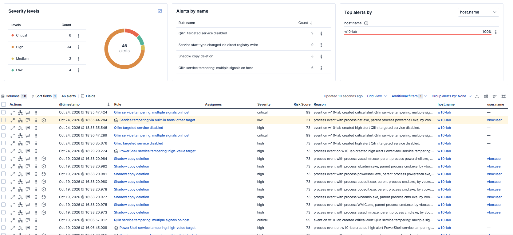

# Qilin ransomware: service-termination and recovery-inhibition detections

A layered set of Elastic (Kibana) detection rules for the service-stop and
recovery-inhibition behavior Qilin ransomware runs before it encrypts, built
and validated in a Sysmon + Winlogbeat homelab.

The rules are exported as importable NDJSON. They are not just queries: each
carries its severity, MITRE mapping, suppression, schedule, and an
investigation guide, so another analyst can import the set and work the alerts
without any outside context.



*The rule set firing against lab and Atomic Red Team activity on `w10-lab`:
the six-branch shadow copy rule, the targeted-disable and registry rules, the
building blocks, and the correlation rule escalating to Critical when distinct
signals land on the same host.*

## The threat

Before encrypting, Qilin stops and disables services, deletes volume shadow
copies, and disables Windows recovery, so the victim cannot restore files and
is pushed toward paying. The design constraint that shaped every rule here:
**Qilin's kill list is configurable per victim.** The service and process
names it targets live in a config the affiliate edits for each environment, so
a rule that only matches a fixed list of service names is brittle by
construction. The set is built to stay useful even when the names change.

References: AhnLab's Qilin analysis, Cisco Talos, and Arete's malware spotlight
(linked in `docs/references.md`).

## Design: four paths to stop a service, each covered

A service can be stopped or disabled four ways. Each leaves different
telemetry, so each needs its own rule. One list-independent rule sits
underneath as a backstop, and a correlation rule sits on top.

| Path to stop a service | What it leaves | Rule |
|---|---|---|
| Service Control Manager (the encryptor's own API calls) | System log 7034/7031/7040 | Rule 1 (burst), Rule 2 (targeted disable) |
| Built-in tools (net, sc, wmic, taskkill) | Sysmon Event 1 (process start) | 3a (high-value), 3b (building block) |
| PowerShell cmdlets / CIM methods | Script block logging, Event 4104 | 4104a (high-value), 4104b (building block) |
| Direct registry write to a service's `Start` value | Sysmon Event 13 (registry set) | Registry rule |

Plus two layers that do not map to a single path:

- **Rule 1 (backstop):** counts distinct services going down on a host,
  independent of any name list, so it still fires on a custom Qilin build.
- **Correlation rule:** counts distinct `Qilin-service-stop` signals per host
  and escalates to Critical when two or more fire together.

And a separate technique:

- **Shadow copy deletion (T1490):** recovery-inhibition tools (vssadmin,
  wmic, PowerShell, wbadmin, diskshadow, bcdedit), kept apart from the
  service rules because it is a different technique with a different response.

## The rules

Ten rules, in `rules/qilin-detection-rules.ndjson`.

| # | Rule | Type | Technique | Severity | Role |
|---|---|---|---|---|---|
| 1 | Qilin: mass service disable or kill | Threshold | T1489 | High | List-independent backstop; 5+ distinct services down per host |
| 2 | Qilin: targeted service disabled | EQL | T1489, T1490 | High | Listed service set to Disabled/Manual (7040); names the actor |
| 3a | Service tampering with built-in tools: targeted services | EQL | T1489 | High | net/sc/wmic/taskkill against a listed service |
| 3b | Service tampering via built-in tools: other target | EQL | T1489 | Low | **Building block.** Same tools, non-listed service |
| 4104a | PowerShell service tampering: high-value target | KQL | T1489, T1059.001 | High | Stop-Service/Set-Service/CIM against a listed service |
| 4104b | PowerShell service tampering: other target | KQL | T1489, T1059.001 | Low | **Building block.** Same cmdlets, non-listed service |
| 5 | Service start type changed via direct registry write | EQL | T1489, T1112 | High | Direct `Start` write (Event 13), bypasses the SCM |
| 6 | Shadow copy deletion | EQL | T1490 | High | Recovery-inhibition tools; six branches incl. resize + diskshadow |
| 7 | Qilin: unlisted service stop following targeted disable | EQL sequence | T1489 | High | **Composition.** Promotes a 3b signal when it follows a confirmed targeted disable |
| 8 | Qilin service tampering: multiple signals on host | Threshold | T1489 | Critical | **Correlation.** 2+ distinct Qilin-service-stop rules on one host |

### How the layers combine

The two building blocks (3b, 4104b) never page an analyst on their own, since
an admin stopping an ordinary service is noise. They are recorded and feed two
higher-order rules:

- **The correlation rule (8)** counts distinct `Qilin-service-stop` signals per
  host. One admin action is noise; the same action next to a disabled backup
  service is a pattern, and that pattern goes Critical.
- **The composition rule (7)** is the more precise one. A stop of an *unlisted*
  service is meaningless alone, but when it *follows* a confirmed disable of a
  service Qilin targets, the unlisted service is likely part of this victim's
  custom kill list. The building block's meaning changes based on what precedes
  it. This is order-aware, where the correlation rule is order-agnostic; the two
  cover each other's blind spots.

## Validation

Tested two ways, with full results in `testing/test-results.md`.

- **Lab services:** six fake Windows services registered under names from
  Qilin's published kill list, so the rules could be fired safely without real
  backup or database software present.
- **Atomic Red Team:** independent tests for T1489 and T1490, so the rules were
  fired by someone else's version of the technique, not only by the author's.
  The T1490 run specifically confirmed the vssadmin-resize and diskshadow
  branches, which a naive delete-only rule misses.

### Honest gaps and known issues

Documented rather than hidden, because knowing a detection's blind spots is
part of the detection. Several issues were found and fixed during development
(rule overlap causing a false Critical, PowerShell keyword matching, the
composition rule, a rule name, a misplaced investigation guide); those are
written up in `docs/known-issues.md`. What remains open is tuning, not bugs:

- **Event 7036 is not logged on the tested Windows 10 build.** A service
  stopped politely through the SCM, with no disable and no kill, is invisible
  to Rule 1 on this build. The command-line and PowerShell rules still catch
  the operator-driven version.
- **The registry rule has no Atomic coverage.** No Atomic test writes a
  service `Start` value directly, so this rule's only validation is manual.
- **No benign baseline yet.** The lab has no production traffic, so the
  false-positive examples in each rule are expected-noise reasoning, not a
  measured rate. The real rate comes from running against production and tuning.
- **Composition rule latency.** Rule 7 reads the alerts index, so in a slower
  production pipeline it could drop chains; the window would be widened or the
  logic moved to raw events. A tuning trade-off, covered in `docs/known-issues.md`.

See `docs/known-issues.md` for the full resolved-and-open breakdown.

## Importing the rules

In Kibana: **Security > Rules > Detection rules (SIEM) > Import**, then select
`rules/qilin-detection-rules.ndjson`.

The rules assume:

- A `winlogbeat-*` data view fed by **Winlogbeat** from a Windows host.
- **Sysmon** installed (process, registry, and other events; the
  [SwiftOnSecurity](https://github.com/SwiftOnSecurity/sysmon-config) or
  [olafhartong/sysmon-modular](https://github.com/olafhartong/sysmon-modular)
  config works).
- **PowerShell script block logging** enabled (for the 4104 rules).
- The correlation and composition rules read `.alerts-security.alerts-default`,
  Elastic's default alerts index.

Full lab build is in `docs/lab-setup.md`.

## Repo layout

```
qilin-detections/
  README.md
  rules/
    qilin-detection-rules.ndjson     # all 10 rules, importable
  docs/
    coverage-map.md                  # the four-path model in detail
    known-issues.md                  # bugs and gaps, with fixes
    references.md                    # threat-intel sources
    lab-setup.md                     # how to reproduce the telemetry pipeline
  testing/
    test-results.md                  # lab + Atomic Red Team results
```

## Author

Built by [Kuzurui](https://github.com/Kuzurui) as a detection-engineering
portfolio project. Rules target Elastic Stack 9.x.
