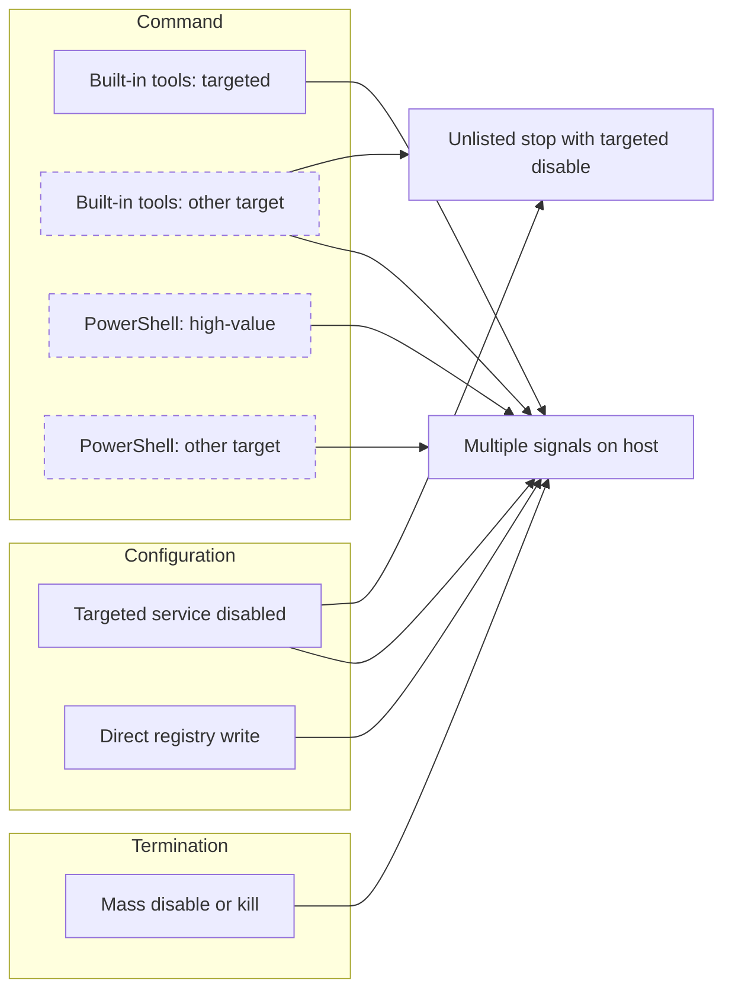

# Architecture

## Three places a service kill leaves evidence

| Layer | What it records | Rules | Blind to |
|---|---|---|---|
| Command | The tool or code that asked for the stop or disable | Built-in tools (Sysmon 1), PowerShell (4104) | The encryptor, which calls the SCM API directly |
| Configuration | The start type changing to Disabled or Manual | Targeted service disabled (7040), direct registry write (Sysmon 13) | Stops that leave the start type alone |
| Termination | The SCM recording a service killed or crashing | Mass disable or kill (7034, 7031, 7040) | Clean stops, since 7036 is not logged in this lab |

No single evasion beats all three layers. An operator who avoids `sc.exe` still changes the start type; an encryptor that never spawns a process still disables services and terminates them in bulk; a direct registry write skips 7040 but is caught by Sysmon 13.

Dashed boxes are building blocks.

## Severity follows base rate

A rule's severity reflects how often its event happens for benign reasons, not how important the target sounds.

- **Standalone, High:** actions that are rare outside an attack or a planned change. A built-in tool aimed at a backup or security service, a targeted service disabled, a direct registry write to a Start value, five or more services disabled or killed in a few minutes.
- **Building block, Low:** actions that happen routinely. Stopping an unlisted service, or any PowerShell match. The 4104 rules are building blocks because they match on co-occurrence: they fire when a stop command and a target name appear anywhere in the same script block, even if the command targeted something else.
- **Correlation, High or Critical:** independent signals on one host within a short window.

## Correlation rules

Both correlation rules read the alerts index rather than raw events.

**Unlisted service stop with targeted disable** (ES|QL) requires a targeted disable and an unlisted-service stop on the same host within 15 minutes, **in either order**. It was originally an EQL sequence, which only matched one order. Mentor review pointed out that an attacker can run the steps in reverse; the rewrite collects both alert types per host and compares the earliest and latest original event times, so order no longer matters. It also uses `kibana.alert.original_time` rather than the alert's `@timestamp`, which is when the source rule happened to run, not when the event occurred.

**Multiple signals on host** (threshold) fires when two or more differently named rules tagged `Qilin-service-stop` alert on one host. This rule has a known false-positive path described in [known-gaps.md](known-gaps.md); a family-based replacement is planned.

## One service list, three spellings

The target list appears in three forms, because each data source names services differently:

| Data source | Form | Example |
|---|---|---|
| Command lines, 4104 script text | What the operator typed | `veeam`, `vss` |
| 7040 `param4`, registry path | Service key name | `VSS`, `MSSQLSERVER` |
| 7040 `param1` | Display name | `Volume Shadow Copy` |

When the list changes, every rule must change with it. Paired rules (targeted and other target) must keep identical verb clauses and differ only in the target list, or commands fall between them.
